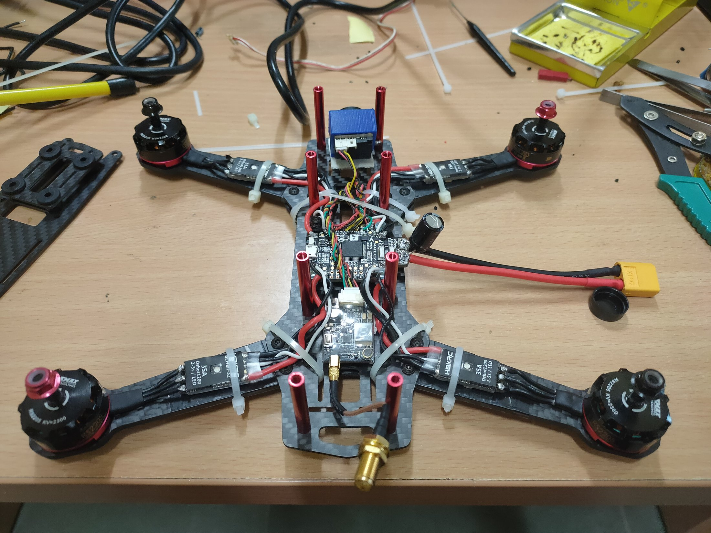
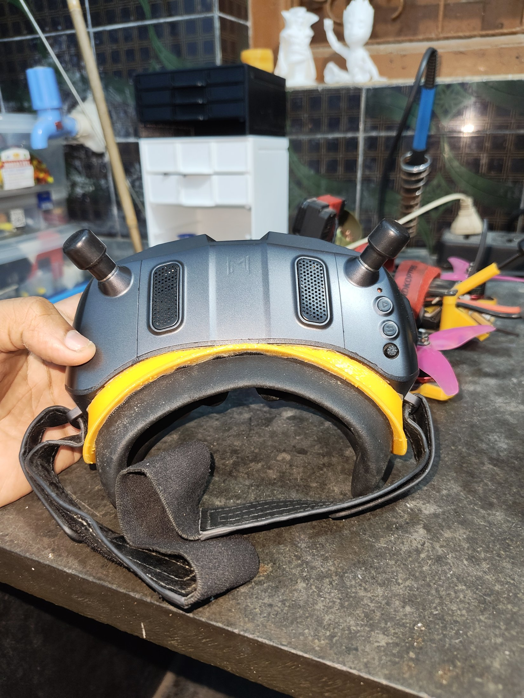
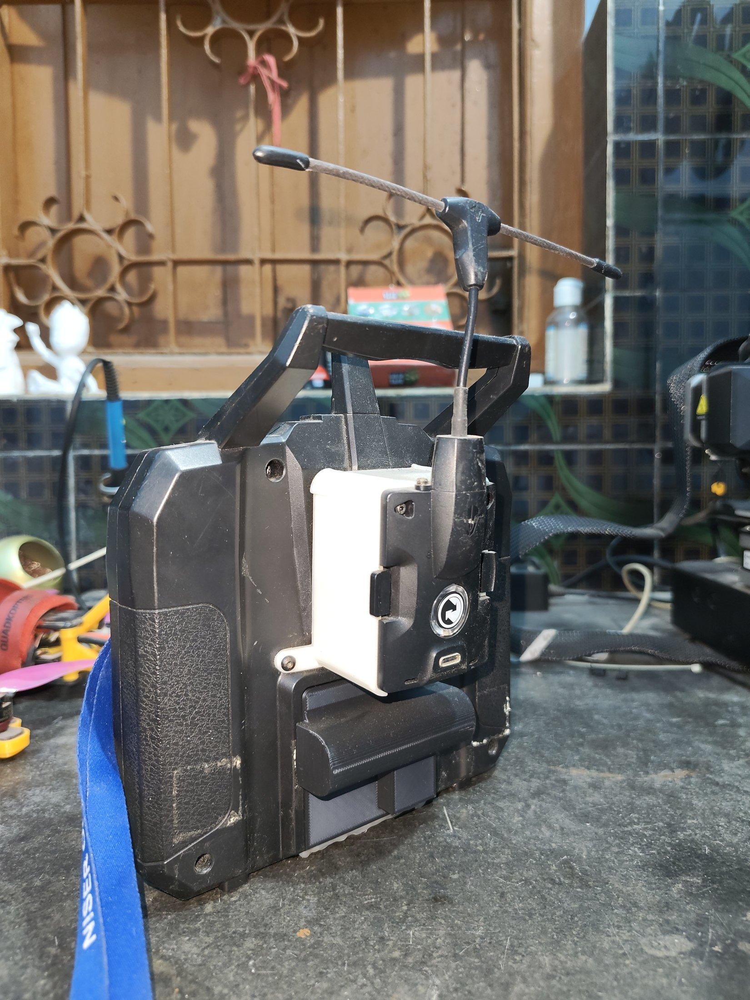
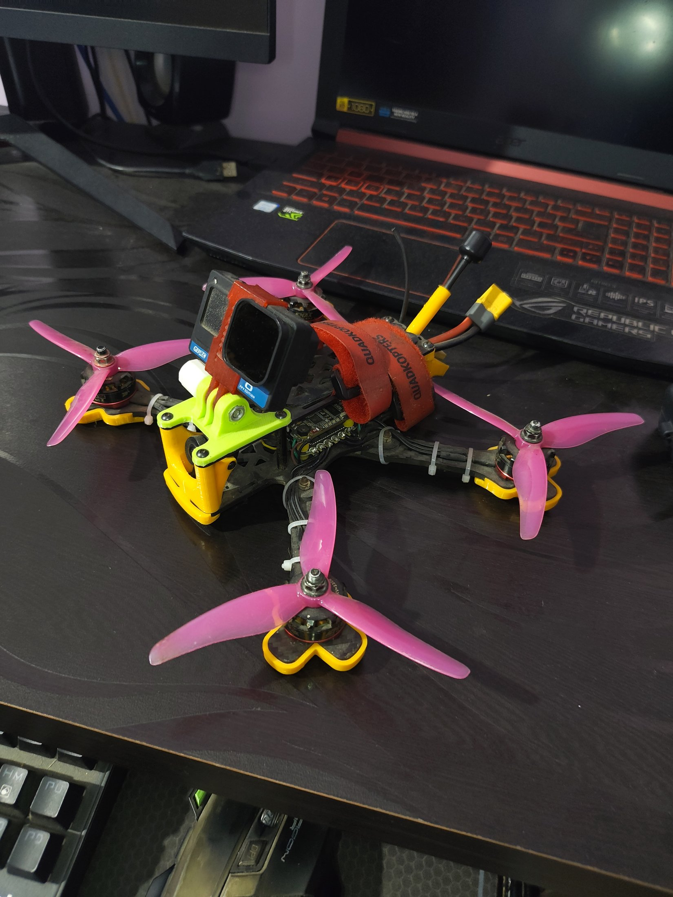
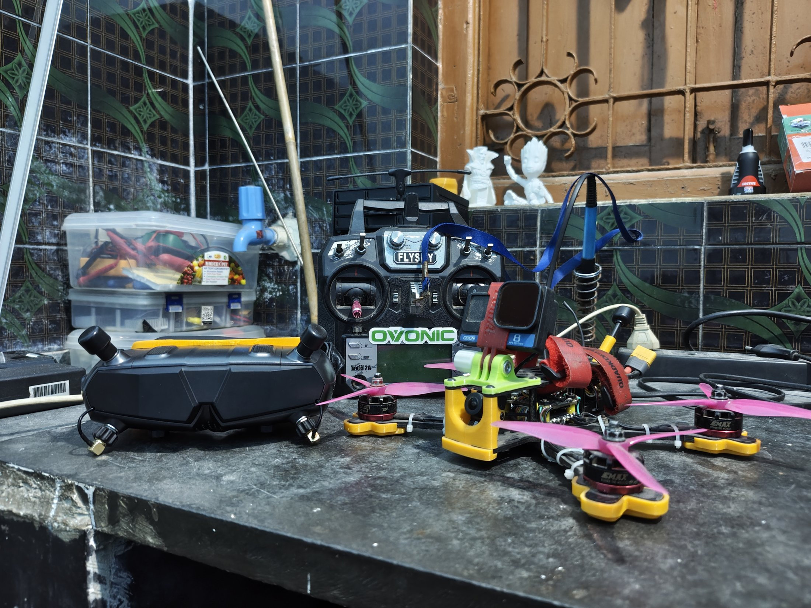

{/* Hidden notes for Sourav (not shown on the site). The upgrade list comes from what you told me and your build page; the order and reasons need your check.
QUESTION: Which digital video system do you fly (DJI, Walksnail, HDZero)? Roughly when did you switch from analog?
QUESTION: Frame size and motors on the first build vs now?
QUESTION: Which ExpressLRS band (2.4 GHz or 900 MHz) gives you the 30 km+ link, and was that range tested or rated?
QUESTION: Anything you tried and went back on? */}

My FPV drone is not really one drone. Since it first flew in 2020, almost every part has been replaced at least once. Here is how it changed, and why. (The story of how I saved up for it is in [From a ₹5,000 scholarship to Chandrayaan-2](/notes/from-a-scholarship-to-chandrayaan-2).)

## 2020: the first build

The first version was a black carbon-fibre frame with red motors and standoffs, a basic camera and analog video. Every part had taken months of saving, and it took about a year and a half to collect them all.

Its first flight didn't end well. I flew it by eye, without goggles, in the self-levelling mode beginners use. I had strapped the battery on with zip ties; it worked loose in the air, slipped into a propeller, and the drone came down. The battery didn't survive.

**Lesson one:** a proper battery strap is not an accessory.

## Learning the software

Before any hardware upgrade, the biggest change was in what I knew. An FPV drone is mostly configuration:

- **Betaflight**, the flight-controller firmware for acrobatic flying: rates, filters and PID tuning.
- **INAV**, a firmware built for navigation and GPS features, for flights where knowing your way home matters.
- **OpenTX** on the radio, later flashed with custom builds: every switch, mix and alarm is programmable.
- **Motor protocols**: how the flight controller talks to the speed controllers, and why the digital ones respond faster and more precisely than the old analog signals.

## Analog to digital video

Analog FPV video has almost no delay, but the picture is fuzzy and full of static at range. Digital systems give a far sharper, cleaner image. That makes it far easier to judge gaps between trees and branches.

## A better radio link: ExpressLRS

The control link moved to **ExpressLRS**, an open-source radio system known for low latency and long range. With it, the drone holds a link over **30 km or more**.

The radio itself got two mods: it now runs on **Li-ion cells** from a 3D-printed battery module with charging built in, and it can take an **external transmitter module**, so the radio link can be upgraded without replacing the radio.

## A GoPro, then a naked GoPro

In August 2023 the drone got a **GoPro**, and with it, real cinematic footage. But a GoPro in its case is heavy for a small drone, and weight is everything: it decides flight time, agility, and how hard a crash hits.

So I took the GoPro out of its case. The bare board sits in a printed mount and draws power straight from the drone's battery, with no GoPro battery at all.

## Printed armour

Once I had a 3D printer (in 2023), crashes stopped being expensive. The drone now wears printed parts: a yellow camera cage and arm guards that take the hits, and when one breaks, I print another.

## Today

The drone now has a **6 : 1 power-to-weight ratio**: its motors can lift six times its own weight, which is what lets it climb and turn so hard. Counting every part, crash and upgrade since 2020, the setup has cost around **₹1.8 lakh**.

Looking back, the upgrades were never really about the drone. Each one was an excuse to learn something new: firmware, radio, video, power, weight. That's the part I'd tell any beginner: start small, crash early, and upgrade one thing at a time, so you know exactly what each change did.
