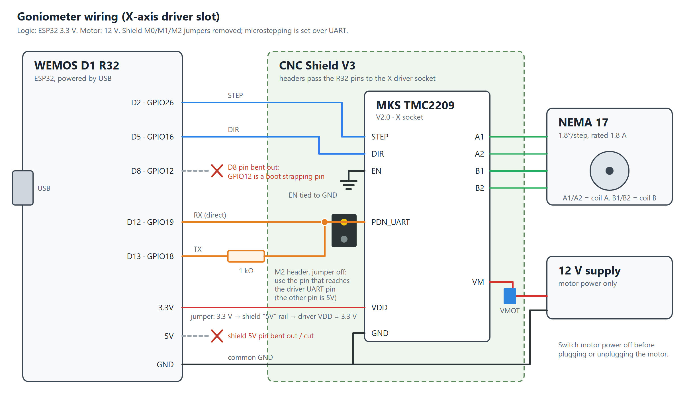

The first axis of my [goniometer](/projects/goniometer) turns an arm through 0–180° from a web page on my phone. Most of the time went into four problems. None was in the control software; every one came from an assumption about a pin, a voltage or a piece of plastic.

## 1. The board that would not boot

The ESP32 kept resetting with a watchdog error. I had put the STEP signal on GPIO8, which is one of the pins the chip uses to talk to its own flash memory. Moving STEP and DIR to GPIO26 and GPIO16 fixed the bare board.

On the CNC shield it failed again, now with `flash read err`. This time the shield's ENABLE line pulled GPIO12 high at power-up, and GPIO12 is a *strapping pin*: the chip reads it at boot to choose its flash voltage. The fix was to bend that one header pin out of the shield and tie the driver's EN pin to ground.

**Lesson:** check every pin against the chip's restrictions before wiring, not after.

## 2. The arm that sagged

At 180° the arm drooped towards the ground, and at 90° it leaned. It looked like a torque problem, so I measured the driver's reference voltage (an estimated 0.9 A of motor current, half the 1.8 A rating) and planned to turn it up.

The pattern said otherwise. Going from 0° to 90° landed exactly on 90°, but coming back from 180° to 90° ended tilted. A difference that depends on the direction you arrive from is *play*, not lost steps. The 3D-printed coupling on the shaft had broken. After I replaced it, the angles were right.

**Lesson:** inspect the mechanics for play before blaming the electronics.

## 3. The driver at the wrong voltage

I wanted to set the driver's current and microstepping from code, over its single-wire UART. Before connecting, I measured the driver's logic supply: **4.7 V**. The ESP32's pins are 3.3 V devices and would not have survived that for long.

The shield was taking its 5 V rail from the ESP32 board. I bent out that one pin and fed the shield's logic rail from the ESP32's 3.3 V instead, so the driver now runs at 3.3 V. A 1 kΩ resistor in the transmit line completed the wiring, and the driver now reports "connected".

**Lesson:** measure a voltage before connecting a pin to it.

## 4. A resolution I did not have

With no jumpers on the shield, the TMC2209 defaults to 1/8 microstepping, which is 0.225° per step. I asked for 0.1° jogs and nothing happened, because the arm cannot move less than one step. The driver does *interpolate* to 1/256 internally, but that only smooths the motion between steps; it does not make the commanded position finer.

Switching to 1/16 microstepping over UART gives **0.1125°**, and the control page now shows the real step size, with jog buttons that move exactly one step.

**Lesson:** show the real resolution in the interface, and do not promise more than the hardware can do.

## Where it goes next

What is still missing is a measured accuracy. The next steps are an endstop for repeatable zero, a comparison of commanded and real angle against a reference, and a stronger coupling with a gear reduction. Then comes the same arm, twice more, for the other two axes. The full build and the wiring are on the [project page](/projects/goniometer).

