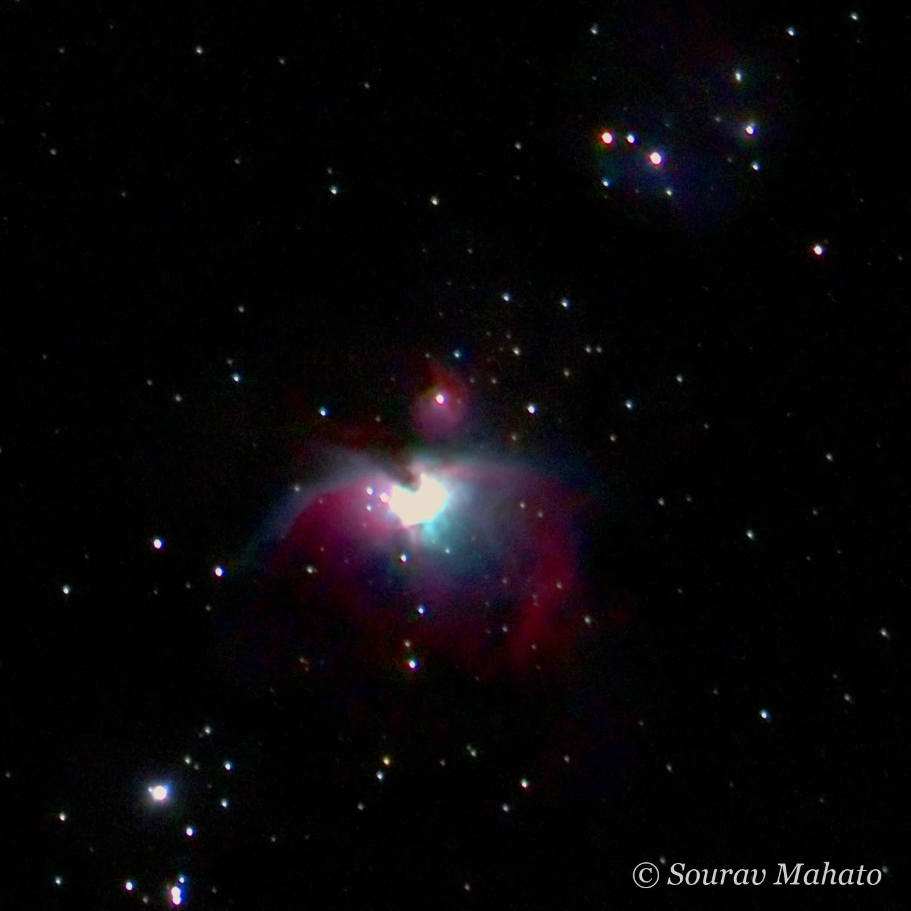

{/* Hidden notes for Sourav (not shown on the site).
QUESTION: Do you still have that first trailed Orion photo? It belongs right under "The first look", as the "before". Even a phone photo of the camera screen would do.
QUESTION: Roughly when was that night (month), and where were you? What lens and exposure, if you remember?
QUESTION: Which object surprised you most after Orion? */}

In October 2024 I bought my first proper camera, a Canon R10. I'd been studying space science for years, so it was never a question where I'd point it. I just didn't know how.

## The first look

I had a tripod and no plan. I found Orion, the easiest constellation to recognise, with its three-star belt, and pointed the camera at the faint smudge just below the belt: the **Orion Nebula**. I took a long exposure and looked at the screen.

The stars weren't points. They were short streaks, all leaning the same way, because the Earth had turned while the shutter was open. By any standard it was a bad photo.

And I was astonished. Behind the streaks was a glowing cloud with soft edges. It looked less like a photo than a painting.

It felt like realising there's a whole world up there, painted on a canvas I had looked at every night without seeing.

## Going deep

That one photo sent me down the deepest rabbit hole I've ever been in. I had to learn why the stars trailed, and how to stop it:

- **Tracking.** The sky turns once a day. To photograph it for minutes, the camera has to turn with it, at exactly the right speed. (I worked out the numbers for my own camera in [Fighting Earth's rotation](/notes/fighting-earths-rotation).)
- **Mounts.** An *alt-azimuth* mount moves up-down and left-right, like a tripod head. An *equatorial* mount tilts one axis to point at the celestial pole, so a single motor can follow the sky.
- **Coordinates.** Right ascension and declination, the sky's latitude and longitude, and the *sidereal* day, 4 minutes shorter than a solar one.
- **Polar alignment, GoTo, plate solving and guiding**: how to point the mount precisely, find targets automatically, check where the camera is really pointing, and correct small drifts while it shoots.
- **Calibration frames**: the strange "blank" photos (darks, flats and bias) that clean up the real ones.
- **Light pollution**: why the sky from a city is orange-grey, and what you can and can't do about it.

Then came the processing. A deep-sky photo isn't one exposure. It's dozens, aligned and stacked to beat the noise. I learned to stack in **DeepSkyStacker** and **Siril**, control the camera with **Astrophotography Tool** and **N.I.N.A.**, and finish the colours in **Lightroom**.

## The answer was a tracker

Everything I read said the same thing: you need a tracking mount, and a good one is very expensive. But I had a 3D printer, some savings, and the skills from my earlier builds. So I built my own: first a simple one-axis [star tracker](/projects/astro-tracker), and then a full GoTo mount with automatic polar alignment and a guide camera.

## The same nebula, again

This is the Orion Nebula again, a stellar nursery about 1,300 light-years away, glowing in the red light of hydrogen. Same camera. The difference is everything I learned between the two photos: a mount I built, frames stacked and calibrated, and a lot of patience.

But it was the first one, trails and all, that showed me there was something to learn. More of what came after is in my [astrophotography gallery](/hobbies/astrophotography).
